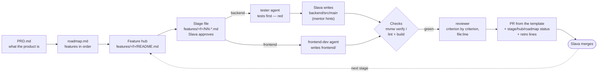

# Docs map — where everything lives

How the project's documents fit together. The approach: a short **product PRD**, a **hub** for each feature
(its short PRD), **stage files** (one stage = one task = one PR), and a **protocol** that keeps their status current
(`AGENTS.md` → "Work protocol").

The last column maps each document to its name in Slava's earlier agent system (`project-keys-v2`), so the
same idea is easy to find under its new name.

## The map

| Why | Here (event-ticketing) | Who writes | Who reads | Was called in project-keys-v2 |
|---|---|---|---|---|
| Rules for every agent | [`AGENTS.md`](../AGENTS.md) (+ [`CLAUDE.md`](../CLAUDE.md) imports it) | Slava | every agent, every task | `CLAUDE.md` ("constitution") |
| What the product is (source of truth) | [`PRD.md`](PRD.md) | Slava | everyone | `docs/design-journal.md` |
| Detailed technical specification (TZ) — source material, unchanged | [`reference/technical-spec.md`](reference/technical-spec.md) | nobody (as given) | task-writer, reviewer, tester | `docs/reference/` |
| Plan with status | [`roadmap.md`](roadmap.md) | task-writer; status — the stage's agent | Slava, task-writer | `docs/roadmap.md` |
| Feature hub (short PRD of a feature) | `features/<feature>/README.md` — first: [`features/auth/`](features/auth/README.md) · template [`_hub-template.md`](features/_hub-template.md) | task-writer with Slava; status — the stage's agent | the doer of every stage, reviewer | a design-journal section + a roadmap line |
| Task | `features/<feature>/NN-*.md` (stage file) · template [`_stage-template.md`](features/_stage-template.md) | task-writer with Slava; "Status" — the doer | doer, tester, reviewer | `tasks/NNN-*.md` + `tasks/_template.md` |
| Roles | [`.claude/agents/`](../.claude/agents/) + `AGENTS.md` → "Who writes what" | Slava | Claude Code | `roles/*.md` |
| Prompts (how a role works) | [`.claude/skills/`](../.claude/skills/) | Slava | the matching subagent | `prompts/*.md` |
| Rule → check | `AGENTS.md` → "Checks" | Slava | everyone | `CLAUDE.md` table, `docs/scripts.md` |
| Proof report | [`.github/pull_request_template.md`](../.github/pull_request_template.md) (the PR description) | the stage's agent | Slava | `reports/NNN/report.md` |
| Retros | [`retro.md`](retro.md) | the stage's agent, in the PR | Slava, task-writer | `docs/system-journal.md` |
| System map | this file | agents (Slava approves) | a new person or agent | `docs/map.md` |
| For people and employers | [`README.md`](../README.md) (Korean + short English) | agents (Slava approves) | recruiters, reviewers | — |
| AI agents setup and the step 4 check | [`agents-setup.md`](agents-setup.md), [`experiments/`](experiments/2026-11-agents-check/README.md) | agents | Slava, reviewers | — |

### Not carried over, and why

| project-keys-v2 | Why not here |
|---|---|
| `docs/trust.md` (trust levels, "may this role merge by itself") | Slava merges every PR, so there is nothing to grant. |
| `progress.md` / `progress.py` | Status lives in `roadmap.md`, hubs and stage files. |
| `docs/scripts.md` | One command per side (`./mvnw verify`, `npm run lint && npm run build`); `AGENTS.md` → "Checks" lists them. |

## How a stage flows



The protocol in one line: **before** work read the hub and the stage file; **after each step** update the stage
file's "Status"; **after the stage** update the hub, the roadmap if needed, and add retro lines — all in the same PR.

## Folders

```
AGENTS.md, CLAUDE.md        rules (Slava)
README.md                   for people (KO + EN)
docs/
  README.md                 this map
  PRD.md                    product truth (Slava)
  roadmap.md                features in order + status
  retro.md                  lessons
  agents-setup.md           Claude Code / Codex / Cursor setup and check
  reference/technical-spec.md   technical specification (TZ), unchanged
  features/
    _hub-template.md, _stage-template.md
    auth/README.md, 01-…05-*.md
  experiments/              evidence of the step 4 check
.claude/agents/, .claude/skills/   roles and their instructions (Slava)
.github/                    CI and the PR template (Slava)
```
