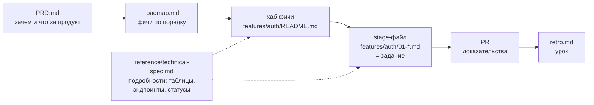
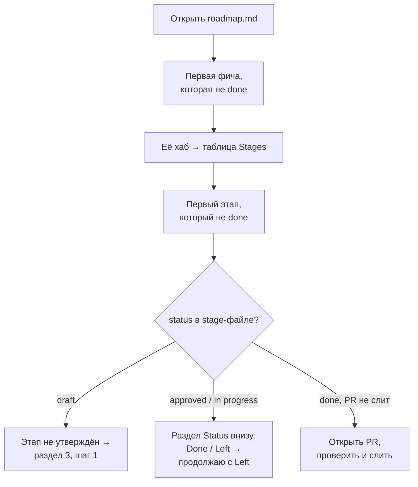
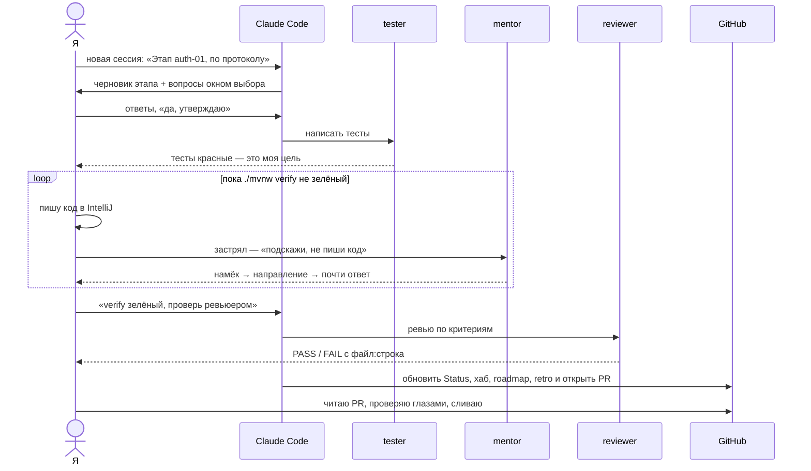
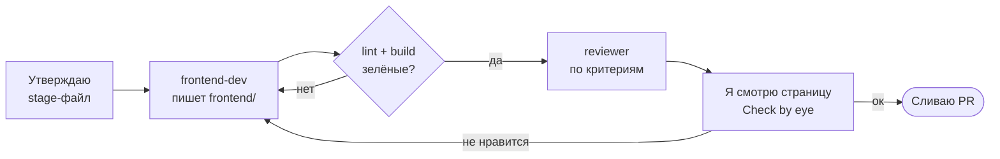

# Мой рабочий протокол (Слава)

Шпаргалка для меня (меняю я; агент — после моего «да»): что делать, что открывать и что говорить агентам на каждом шаге. У агентов свой протокол —
`AGENTS.md` → "Work protocol"; этот — мой. Забыл, где я, — начни с раздела 2.

## 1. Главное в пяти строках

1. Я пишу только `backend/src/main/`. Остальное пишут агенты; я утверждаю, проверяю и сливаю.
2. Единица работы — **этап** (stage): одно задание = одна сессия Claude Code = одна ветка = один PR.
3. Что строим и в каком порядке — [`roadmap.md`](roadmap.md). Что делаем сейчас — stage-файл этапа.
4. Решения (библиотека, формат, правило) принимаю я — агент спрашивает окном выбора, я отвечаю.
5. Этап закончен, когда я слил PR. Потом — новая сессия на следующий этап.

### Документы — от «зачем» до «что вышло»

Каждый день я открываю только три: **roadmap → хаб → stage-файл**. PRD и technical-spec — справочники, их
читают агенты; я заглядываю туда, когда нужен ответ «почему так» или «как именно по ТЗ».

## 2. Где я сейчас? (1 минута)

Пример. В roadmap у «Sign-up and sign-in» стоит `not started` → хаб `features/auth/README.md` → этап 01 в статусе
`draft` → значит, сначала утвердить этап 01.

## 3. Бэкенд-этап — мой цикл

| Шаг | Что делаю я | Что открываю | Что говорю |
|---|---|---|---|
| 1. Начать | Открываю **новую** сессию Claude Code в папке проекта | — | «Этап auth-01. Работаем по протоколу AGENTS.md.» |
| 2. Утвердить | Читаю 4 раздела этапа: Goal, Who writes what, Acceptance criteria, Out of scope. Отвечаю на вопросы окном выбора | stage-файл | «Да, утверждаю» или что поменять |
| 3. Тесты | Смотрю имена тестов и что каждый проверяет — это и есть моя задача | тесты в `backend/src/test/` | «Напиши тесты к этапу» |
| 4. Код | Пишу код, запускаю `cd backend && ./mvnw verify`, пока не зелёный | IntelliJ | застрял: «подскажи, как…, код не пиши»; ошибка: `/explain-error` + текст ошибки |
| 5. Ревью | Читаю вердикт. FAIL — назад к шагу 4 | ответ ревьюера | «Verify зелёный, проверь этап ревьюером» |
| 6. PR | Агент обновляет документы и открывает PR. Я читаю PR, делаю «Check by eye», сливаю | PR на GitHub | «Открой PR по шаблону» |
| 7. Закрыть | Архивирую сессию | — | «Заархивируй сессию» |

## 4. Фронтенд-этап — короче

Что говорю: «Этап auth-05, по протоколу» → утверждаю → «делай» → после ревью смотрю страницу по списку
«Check by eye» из stage-файла.

## 5. Новая фича

Когда все этапы фичи `done`: новая сессия → «Подготовь следующую фичу из roadmap». Автор заданий (task-writer)
пишет хаб и черновики этапов. Я читаю хаб (одна страница) и проверяю, понятно ли, какие этапы мои. Дальше —
раздел 3 для каждого этапа.

## 6. Кого как позвать

| Хочу | Говорю | Кто отвечает |
|---|---|---|
| Подготовить этап или фичу | «Подготовь этап auth-02» / «подготовь следующую фичу» | task-writer |
| Тесты до кода | «Напиши тесты к этапу auth-02» | tester |
| Понять, как сделать, без готового кода | «Подскажи, как сделать X, код не пиши» или `/mentor-backend` | mentor |
| Разобрать ошибку или красный тест | `/explain-error` + текст ошибки | mentor (скил explain-error) |
| Проверить готовый этап | «Проверь этап ревьюером» или `/review-task` | reviewer |
| Страницу фронта | «Сделай этап auth-05» | frontend-dev |

## 7. Если что-то пошло не так

| Ситуация | Что делаю |
|---|---|
| Агент предлагает сам написать код в `backend/src/main/` | Отказываю: «объясни, что поменять, — напишу сам». Хук и так должен заблокировать. |
| Тест кажется неправильным | Не подгоняю код под тест. Говорю: «тест X кажется неверным, потому что…» — агент обязан остановиться и спросить. |
| `./mvnw verify` красный, непонятно почему | `/explain-error` и вывод ошибки. Падает только стиль — `./mvnw spotless:apply`. |
| Агент правит то, что этап не разрешает | Стоп, откатить. Запись в `retro.md`. |
| Забыл, где я | Раздел 2. |
| Сессия стала длинной | Закончить этап, следующий — в новой сессии (урок project-keys-v2: длинные сессии съедали ~¾ денег). |

## 8. Мои файлы — их правлю только я (или агент после моего «да»)

`AGENTS.md`, `CLAUDE.md`, `docs/PRD.md`, `.claude/`, `.codex/`, `.cursor/`, `scripts/`, `.github/`, `pom.xml`,
шаблоны в `docs/features/` — и весь код в `backend/src/main/`. Агенты предлагают правку в чате; я отвечаю «да» на
каждую отдельно. Полная таблица: `AGENTS.md` → "Who writes what". Карта всех документов: [`README.md`](README.md).
